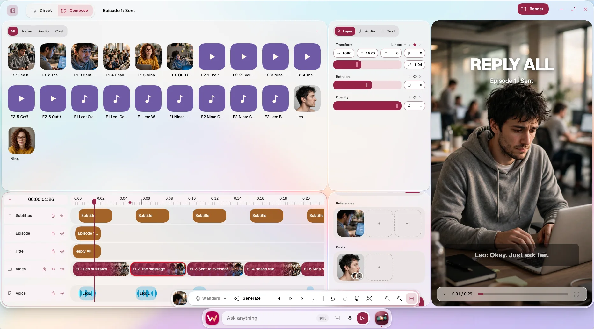

# Wedyan



A browser desktop you share with your AI agent. You both use the same apps and the same tools, and the agent works from the apps' real state, not from screenshots.

You say what you want, in words or by voice. The agent answers in structured data: text to show, text to speak, widgets, and actions on the desktop, timed to what it is saying.

> Built for the Meta Global AI Developer Hackathon (Oct 26 – Nov 4, 2026).

## Built with

- **[AirLib](https://airlib.dev)** (open source, by the same author): reactive state, IRPC (type-safe calls with streaming and two-way ask/answer), r2-file (filesystem on Cloudflare R2 and D1), r2-image (picture resizing on R2 and Containers), ai-kit (one API over AI providers), Aria (headless UI behavior, including the video stage and its renderer) and [AUI](https://aui.airlib.dev) (the UI component library).
- **Meta models:** Muse Spark 1.3 for the assistant, Muse Spark Open on Baseten for the router, Wonder by default for generating a motion project, Muse Voice Transcribe for speech, Muse Image for photos.
- **Open-source models:** BGE-M3 by BAAI (MIT) for the embeddings behind memory and file recall, and MeloTTS by MyShell (MIT) for speaking answers aloud, both on Cloudflare Workers AI.
- **Libraries:** [GSAP](https://gsap.com) for the keyframed motion of every clip, [Mediabunny](https://mediabunny.dev) for decoding a project's media and encoding its MP4, [Zod](https://zod.dev) for the schemas of every tool and call, and React, through AirLib, for JSX.
- **Cloudflare:** Workers, Durable Objects (one per session), Containers, R2, D1, Vectorize, Queues, Workers AI.

## Why

Most agents that operate software look at pixels and guess. Every app already knows its own facts: what is open, what is selected, what a button does. Wedyan gives the agent those facts as data, and gives it the same buttons as tools. So the agent acts on what is true, the user can see and undo what it did, and nothing has to be generated as code when a tool already exists.

### Everything is a file

What you and the agent make lives as files in your home: a motion project and its stages, takes, stills and sounds, a person, a memo, your settings. So:

- **You and the agent work on the same thing.** It reads and writes the files the apps open, with the same tools.
- **Anything opens by its path.** A link to a file, from a widget or from any app, opens it in the app that owns it.
- **Memory recalls by content.** Files are indexed as they are written, so the agent finds what you mean, not only what something is called.
- **The formats are open.** A file written outside Wedyan, in the documented format, opens like one made inside it.

## What it does

You ask, in words or by voice, and the agent works in the same apps you do. It finds and opens your files, remembers what you tell it, designs people for your stories, generates pictures, and builds projects in Motions.

It answers on the desktop: it speaks, shows what is better seen than read as a widget, asks with a form when it needs something from you, and acts in the apps, each at the point in its answer where it says so.

### For example: a whole project from one description

In Motions, describe what you want to make, a motion graphic or a film in episodes, and the agent builds it as a project:

> Make a short drama in five episodes, about a minute each.

The agent plans the work, asks the system for the turns it needs, and makes:

- **The script**, for each episode.
- **The cast**: a person per character, with their face and figure.
- **A stage per episode**, with tracks of clips on a timeline.
- **Stills** for each shot, generated and placed on the timeline.
- **Takes** holding the prompt for each shot's video.
- **Sounds**, placed on the timeline with the shots.

The project plays in Motions as it is made: a storyboard you can watch, edit by hand or by asking, and render. Every new home comes with two sample projects: a motion graphic and a series in episodes.

## Capabilities

### Motions: storyboards you can play

A motion project is a script, its cast, and a stage per episode: tracks of clips on a timeline, previewed as they play. You can compose it by hand, ask the agent to, or both.

A take holds what a shot's video should be: its prompt, its references and who is in it. Its first attempt can be a single picture, which plays for as long as the take runs. *Why:* a picture costs far less than a video, so a shot is got right before a video is paid for. Wedyan doesn't generate the videos yet; a take keeps everything one needs.

A stage renders to an MP4 in the browser, from the same stage the preview plays. *Why:* what you render is what you saw, with no render server.

### Lounge: people, designed once and used everywhere

Lounge is where you design people, the characters of your stories: their faces, their figures and what they are like. A shot with someone in it sends their pictures to the image model, and the agent uses what they are like to write better prompts. *Why:* a character looks like themselves from shot to shot.

Lounge is also meant to hold agents: skilled agents you assign to a project, or even to a single clip. That part doesn't work yet.

### Memo: what you want remembered

Memo is where you keep your own notes, or ask the agent to remember something. *Why:* when an ask or a task needs it, the agent recalls it from memory instead of asking you again.

### Photos: your pictures

Photos is where you browse your pictures and generate new ones.

### Preview and links: every file opens

Preview opens Wedyan's own file types. A file is reached by a link, `app:~/path`, or by its path alone, from a widget or from any app. *Why:* the agent can point at what it made, and one click opens it in the app that owns it.

### Widgets and forms: UI as data

When something is better seen than read, the agent describes it: what it is for, and the data to show, exactly. A second agent composes that into the desktop's own components, never into code. A form works the same way: the agent asks for what it needs, and submitting the form runs an action on the desktop. *Why:* the agent says what the user needs, not how it looks; every widget is drawn from the same component library, so it looks like the rest of the desktop and can't run anything it wasn't given.

### One set of tools, for the apps and the agents

Every change to a document is one function: create a motion project, add a stage, place a clip on a track, generate a still. The apps call these functions when you click, and the agents call the same functions as tools. *Why:* there is no separate agent API that can drift from what the apps do.

- [`lib/agents/TOOLS.md`](lib/agents/TOOLS.md) lists the tools, their arguments and what they return.

### An open document format

[`lib/documents/DOCUMENTS.md`](lib/documents/DOCUMENTS.md) specifies the document formats: a motion project, its stages, tracks, clips, stills, takes and sounds. They are plain JSON. *Why:* anything that writes them, by hand or by another program, makes a project Wedyan plays.

### Long tasks finish

An agent estimates the turns a task needs and asks for them; the system sets its limit and tells it when it is running low. *Why:* ten episodes take far more turns than one answer, and a fixed limit would stop the work halfway.

### Settings

The theme, dark by default, and the assistant: its name, how fast it speaks, and how it behaves, in your own words.

## How an ask works

One ask is one streaming call. Everything happens inside it:

- **Routing.** A fast router model answers simple asks itself or hands off to a specialist agent. A handoff passes a brief and what is already known, not the previous agent's reasoning.
- **Answer.** The model writes Markdown with a few markers: `[[narrate]]` for what to speak, `[[widget]]` for something to show, `[[ask_user]]` for a form, and `[[action]]` for something to do at that point in the answer. The kernel turns this into parts that stream to the desktop.
- **Actions.** Actions run on the desktop in order, each when the words before it have been shown or spoken. A failure is reported back to the model, which adjusts.
- **Questions both ways.** The agent can ask the desktop for state or ask the user a question mid-task; the user can add a follow-up or say "never mind" while the agent works. Both go over the same live call.
- **Tools.** System calls (files, documents, memory) run on the server; app calls are answered by the app that owns the state.

## What was built during the event

Everything in this repository was written during the event. It builds on AirLib and AUI, open-source libraries that existed before it.

## Running it locally

You need [Bun](https://bun.sh), [Docker](https://www.docker.com) and a Muse API key. A Cloudflare account is optional.

1. Install the dependencies:

   ```bash
   bun install
   ```

2. Put your keys in `.env`:

   ```bash
   MUSE_API_KEY=…
   # Optional: runs the router on Muse Spark Open, on Baseten.
   BASETEN_API_KEY=…
   # Optional: lists Google Fonts in Motions.
   GOOGLE_API_KEY=…
   ```

3. Choose how it runs with Cloudflare. Memory, file search and the spoken voice run on Vectorize and Workers AI, in a Cloudflare account. Either sign in, to have them:

   ```bash
   bunx wrangler login
   ```

   Or run without them, and without signing in, by adding to `.env`:

   ```bash
   REMOTE_BINDINGS=false
   ```

   Everything else works the same. Files, documents and pictures stay local either way.

4. Start the picture resizer, which `RESIZER_URL` in `wrangler.json` points at:

   ```bash
   docker run -d -p 8080:8080 mahdaen/r2-image:2.2.0
   ```

5. Start the desktop:

   ```bash
   bun run dev
   ```

   It serves on `http://localhost:6173`. Each browser gets its own home, seeded with sample files and sample Motions projects.

To run the tests: `bun run test`. Only external model APIs are mocked.

### Browser

Use Chrome. Rendering a motion to MP4 draws the stage's HTML into a canvas, which Chrome has behind an experimental flag:

1. Open `chrome://flags/#canvas-draw-element`.
2. Set the highlighted flag to **Enabled**.
3. Relaunch Chrome.

Everything else works without the flag.

## Project layout

| Path | What it holds |
|---|---|
| `lib/kernel/` | The agent kernel: the ask loop, routing and handoff, the turn budget, the response-format parser, parts and actions. `*.h.ts` files are contracts shared by client and server; the matching `*.ts` files are server-side. |
| `lib/agents/` | The agents, their skills, and the tools they are given. |
| `lib/system/` | The `sys.*` document tools, one function each, shared by the apps and the agents. |
| `lib/documents/` | The document formats and the file types the desktop knows. |
| `lib/memory/` | Memory and file recall, on Vectorize. |
| `lib/server/` | Server setup, sessions, seeding and picture delivery. |
| `lib/systems/` | Desktop boot, the prompt, commands and links. |
| `apps/` | The built-in apps. |
| `components/` | Shared UI components. |
| `seeds/` | What every new home starts with. |
| `pages/`, `src/` | Routes, app entry and the worker. |
| `server/` | Runtime entries (Cloudflare Workers, Bun, Node, Deno). |
| `test/` | Test suites. |

## License

[MIT](LICENSE.md).
